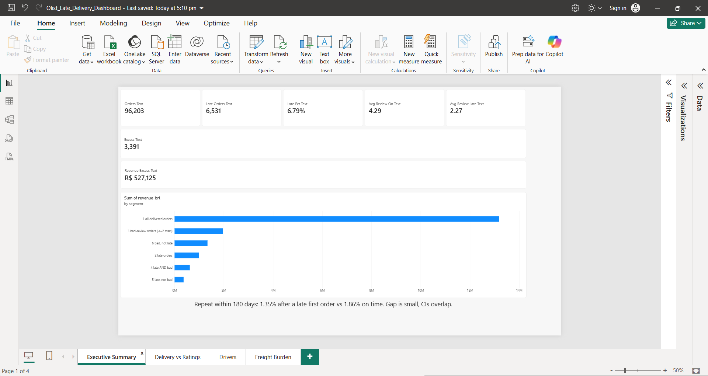
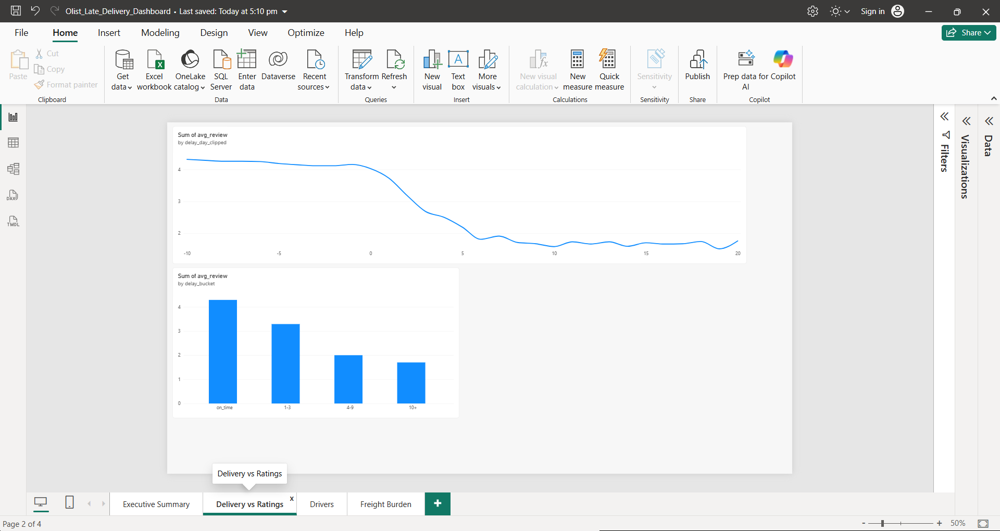
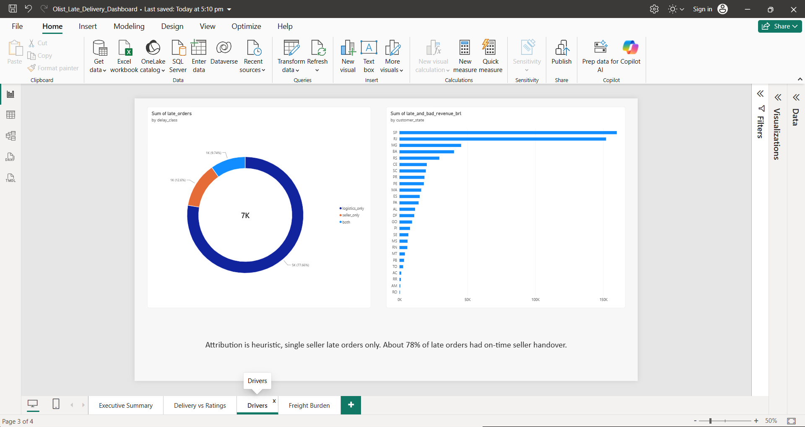
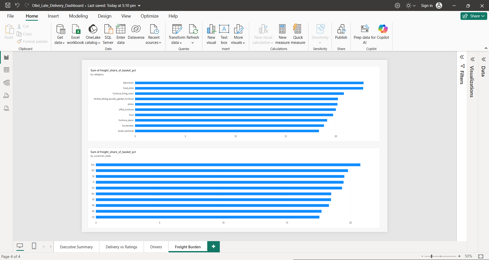

# 📦 Olist Late Delivery Analysis

**How much revenue is associated with late deliveries and bad reviews, and which states and sellers drive it?**


An end-to-end SQL + Power BI analysis of **96,203 delivered orders** from the Olist Brazilian E-Commerce dataset (1 Jan 2017 – 31 Aug 2018). It links delivery delays to review scores, sizes the revenue exposed to that gap, and separates logistics-driven lateness from seller-driven lateness.

> [!IMPORTANT]
> **Wording rule:** everything here is *"associated with"*, never *"lost"* or *"profit"*. Late orders were already paid for, so no revenue is lost. There is no cost data, so no profitability is claimed. The analysis shows association, not causation.

---

## 🔑 Key Findings

| | Finding | Value |
|---|---|---|
| ⏱️ | Late deliveries | **6.79%** (6,531 of 96,203 orders) |
| ⭐ | Average review score | **4.29** on-time vs **2.27** late |
| 👎 | Bad-review rate | **9.25%** on-time vs **62.42%** late |
| 📉 | Excess bad reviews | **3,391**, i.e. 27.7% of all 12,228 bad reviews |
| 💰 | Item revenue associated | **R$527,125** (≈ ₹85.6 lakh) |
| 🚚 | Who causes the lateness | **77.7%** logistics-only, 12.6% seller-only, 9.7% both |
| 📍 | Geographic hotspot | **Rio de Janeiro**: 12.8% of orders but 24.6% of late-and-bad revenue |
| 🔁 | Repeat buying | 1.35% after a late first order vs 1.86% on-time (small gap, confidence intervals overlap) |

---

## 📊 Dashboard

A 4-page Power BI dashboard (`powerbi/Olist_Late_Delivery_Dashboard.pbix`). Every number is built from the CSVs in `results/`, with no DAX recalculation of base metrics.

### 1️⃣ Executive Summary



- Total item revenue **R$13,179,778** (≈ ₹213.9 million). Late orders carry R$985,618 (7.48%); late **and** bad-review orders carry R$618,806 (4.70%).
- Repeat purchase within 180 days: **1.35%** [0.98, 1.86] after a late first order vs **1.86%** [1.75, 1.98] on-time. The intervals overlap, so this does not show that late delivery kills repeat buying.

### 2️⃣ Delivery vs Ratings



Reviews fall steeply over the first 6 days of delay (4.03 at 0 days → 1.81 at 6 days), then flatten around 1.6–1.7.

| Delay bucket | Orders | Avg review | Bad-review rate |
|---|---:|---:|---:|
| On-time | 89,672 | 4.29 | 9.25% |
| 1–3 days late | 1,869 | 3.29 | 32.14% |
| 4–9 days late | 2,365 | 2.00 | 70.48% |
| 10+ days late | 2,297 | 1.70 | 79.24% |

### 3️⃣ Drivers: Logistics, Sellers, States



- **Logistics dominates:** of 6,517 classified late orders, 5,061 (77.7%) were logistics-only, 821 (12.6%) seller-only and 635 (9.7%) both. 14 orders were excluded (13 multi-seller, 1 missing carrier date).
- **Rio de Janeiro is over-represented ~1.9x:** 12,310 orders (12.8%) but R$152,004 (24.6%) of late-and-bad revenue, with a 12.14% late rate vs 4.50% in São Paulo. SP has more late-and-bad revenue in absolute terms (R$159,885) but on 42.0% of orders.
- **Controlled regression:** relative to on-time, bad-review probability rises by **+22.5 / +60.8 / +69.0 pp** for 1–3 / 4–9 / 10+ days late (seller effects absorbed by demeaning).

### 4️⃣ Freight Burden



Freight burden = freight as a % of basket value (price + freight). It is not a profitability measure.

- **Highest by category:** electronics 22.8%, food_drink 22.7%, furniture_living_room 20.8%
- **Highest by state:** MA 20.8%, RO 19.8%, SE 19.5%. Remote states carry the heaviest burden.

---

## 🧪 Methodology

1. Load the 8 core Olist CSVs and build `v_order_base` (`sql/01_base_views.sql`): delivered orders only, purchased between 2017-01-01 and 2018-08-31, one review per order, revenue = `SUM(price)`, freight kept separate.
2. Run queries 02–08 in `sql/`; outputs are written to `results/` (21 CSVs).
3. Reconcile against payments: price + freight of R$15,371,741 vs payments of R$15,374,497, a gap of R$2,755 (**0.02%**).
4. Build the dashboard only from `results/`. If a visual needs a number that is not in a CSV, add the query and re-export first.

**Data fix worth noting:** an earlier run gave 96,211 orders / 6,539 late. Eight delivered orders with no delivery date were stored as empty strings instead of `NULL` and slipped through. Converting empty strings to `NULL` gave the corrected base of **96,203**. Full reconciliation table in [`docs/DECISIONS.md`](docs/DECISIONS.md).

---

## ⚠️ Limitations

- **Seller-controlled gap rests on 53 sellers.** Only sellers with 20+ late and 20+ on-time reviewed orders qualify (2,496 late orders). The joint regression above is the more reliable estimate.
- **The logistics/seller attribution is a heuristic.** It assumes one day of seller handover delay shifts delivery by one day, and it cannot see how Olist built the delivery estimate.
- **Repeat-buying gap is small** and the confidence intervals overlap.
- **Association, not causation.** Bad reviews can have causes other than lateness.

---

## 💱 Currency

R$ is the primary currency. INR is shown for scale only, at a fixed rate of **1 BRL = 16.233 INR** (17 Nov 2026, exchange-rates.org), set once in `sql/06_revenue_associated.sql` and once as a Power BI parameter. If the rate moves, the ₹ figures move; the R$ figures do not.

---

## 🗂️ Repository Structure

```
Olist-Late-Delivery-Analysis/
├── sql/                     # Schema, load, base views, queries 02–08
├── results/                 # 21 CSVs; every dashboard number traces to one of these
├── powerbi/
│   ├── Olist_Late_Delivery_Dashboard.pbix
│   ├── Olist_PowerBI_Data.xlsx          # All results + FX parameter
│   ├── POWER_BI_BUILD_SPEC.md           # Step-by-step dashboard build
│   ├── dashboard.html                   # Readable 4-page preview
│   └── screenshots/real_powerbi/        # p1–p4 dashboard screenshots
├── notebooks/               # Supporting Python analysis
├── docs/DECISIONS.md        # Every rule, definition and the FX record
├── run_queries.py
├── run_all.sh
└── requirements.txt
```

---

## 🚀 Reproduce

```bash
git clone https://github.com/Ayush8356/Olist-Late-Delivery-Analysis.git
cd Olist-Late-Delivery-Analysis
pip install -r requirements.txt
```

Download the [Brazilian E-Commerce Public Dataset by Olist](https://www.kaggle.com/datasets/olistbr/brazilian-ecommerce) from Kaggle, then run:

```bash
bash run_all.sh
```

---

## 🛠️ Tech Stack

| Layer | Tools |
|---|---|
| Data modelling & analysis | SQL |
| Visualisation | Power BI Desktop (DAX, Power Query) |
| Automation & stats | Python |
| Dataset | [Olist Brazilian E-Commerce](https://www.kaggle.com/datasets/olistbr/brazilian-ecommerce) (Kaggle) |

---

## 👤 Author

**Ayush Pal** · Data Analyst / ML Engineer aspirant · [GitHub](https://github.com/Ayush8356)
